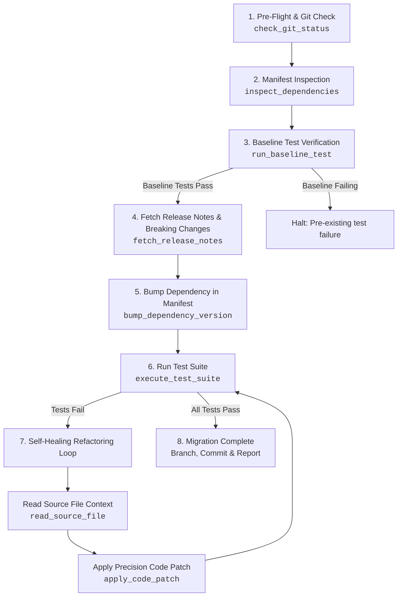

# DepShift

[](https://www.python.org/downloads/)
[](https://modelcontextprotocol.io/)
[]()
[](https://opensource.org/licenses/MIT)

**DepShift** is an autonomous, context-aware dependency migration and security remediation agent packaged as a **Model Context Protocol (MCP)** server.

It transforms AI clients (like Claude Desktop, Cursor, or ChatGPT) into a dedicated software engineer that doesn't just bump version numbers—it reads migration guides, refactors deprecated syntax, and iterates in a local test loop until the entire test suite passes.

---

## 1. The Problem DepShift Solves: "The Dependabot Dilemma"

Modern software projects rely heavily on open-source dependencies. Automated tools like **Dependabot**, **Renovate**, and **Snyk** do a great job alerting developers when dependencies are outdated or vulnerable.

However, they suffer from a fundamental limitation:

```
[ Dependabot / Snyk ]
        │
        ▼ (Opens PR bumping version in pyproject.toml / package.json)
┌────────────────────────────────────────────────────────┐
│  CI / Test Suite FAILS (Breaking Changes / Deprecated API)│
└────────────────────────────────────────────────────────┘
        │
        ▼ (PR sits unmerged for months; technical debt piles up)
```

### The Real-World Pain:
- **Major Framework Upgrades Stall:** When a library introduces breaking changes (e.g., Pydantic v1 $\rightarrow$ v2, Next.js 12 $\rightarrow$ 14, SQLAlchemy 1.4 $\rightarrow$ 2.0), simple version bumps fail tests immediately.
- **Expensive Engineering Hours:** Senior developers spend days or weeks manually reading release notes, finding call sites across hundreds of files, and rewriting boilerplate code.
- **Blocked Security Audits:** Compliance standards (SOC2, ISO-27001, FedRAMP) require remediating critical CVEs within strict deadlines (e.g., 30 days). Teams are frequently blocked because upgrading a vulnerable package breaks other parts of their application.

---

## 2. What is DepShift?

**DepShift** bridges the gap between **knowing** a package is outdated and **actually writing the code changes** to upgrade it safely.

Instead of opening a broken PR, DepShift:
1. **Inspects** the repository workspace and enforces strict Git safety.
2. **Verifies** baseline test health (ensuring existing tests pass *before* touching code).
3. **Fetches migration guides & changelogs** from GitHub Releases, PyPI, and npm, isolating breaking changes.
4. **Bumps** the dependency version in manifest files (`pyproject.toml`, `requirements.txt`, `package.json`).
5. **Executes an autonomous self-healing loop:** reads failing tests, inspects source files, applies precision code patches, and re-executes tests until green.
6. **Commits** intermediate fixes to a dedicated migration branch and drafts a structured summary report.

---

## 3. How DepShift Works

DepShift is designed around an autonomous self-correcting feedback loop:



### Detailed Operational Lifecycle:

1. **Pre-flight & Git Safety Check:** Ensures the repository exists, is a valid Git repo, and has a clean working tree so ongoing work is never overwritten.
2. **Manifest & Dependency Discovery:** Automatically detects Python (`pyproject.toml`, `requirements.txt`) and Node.js (`package.json`) ecosystems and parses installed packages.
3. **Baseline Health Guardrail:** Executes existing tests (`pytest`, `npm test`, etc.) *before* mutating any files. If tests are already failing, it stops immediately so the upgrade isn't blamed for pre-existing bugs.
4. **Changelog & Breaking Change Intelligence:** Ingests documentation from PyPI/npm and official GitHub Releases. Filters out noise and surfaces only `Breaking Changes`, `Deprecations`, and `Migration Guides`.
5. **Precision Code Patching:** Reads source files with line-number boundaries and applies atomic, whitespace-preserving search-and-replace patches without corrupting file encodings.
6. **Bounded Self-Healing Loop:** Captures structured tracebacks from failing tests, points the LLM to failing call sites, applies refactorings, and re-runs tests until 100% green.

---

## 4. Model Context Protocol (MCP) Tools

DepShift exposes a suite of specialized tools over the Model Context Protocol:

| Category | MCP Tool Name | Description |
| :--- | :--- | :--- |
| **Diagnostics** | `ping` | Health-check tool verifying MCP server connectivity. |
| **Diagnostics** | `get_version` | Returns server metadata, version, runtime Python, and host platform. |
| **Git Safety** | `tool_check_git_status` | Verifies clean working tree, active branch, and valid git repository. |
| **Git Lifecycle** | `tool_create_migration_branch` | Creates and checks out a dedicated migration branch for the upgrade. |
| **Git Lifecycle** | `tool_commit_migration_step` | Stages files and commits intermediate refactoring steps with clear messages. |
| **Manifests** | `tool_inspect_dependencies` | Detects project ecosystems and extracts dependencies across Python/Node. |
| **Manifests** | `tool_bump_dependency_version` | Safely updates dependency version specifier in manifest files. |
| **Intelligence** | `tool_fetch_release_notes` | Fetches release notes from PyPI, npm, and GitHub Releases. |
| **Intelligence** | `tool_extract_breaking_changes`| Scans documentation to extract breaking changes and deprecations. |
| **Refactoring** | `tool_read_source_file` | Reads source files with line numbering and bounded line slicing. |
| **Refactoring** | `tool_apply_code_patch` | Performs precision search-and-replace patches without corrupting code. |
| **Test Runner** | `tool_run_baseline_test` | Executes test suite with strict security guardrails and timeout bounds. |
| **Test Runner** | `tool_execute_test_suite` | Runs tests and returns structured failure lists with error reasons. |
| **Reporting** | `tool_generate_migration_summary` | Generates complete audit-ready Markdown PR summaries with diff stats. |

---

## 5. Client Configuration Guide

DepShift connects natively to any MCP-compatible AI client.

### Claude Desktop
Add DepShift to your `%APPDATA%\Claude\claude_desktop_config.json` (Windows) or `~/Library/Application Support/Claude/claude_desktop_config.json` (macOS):

```json
{
  "mcpServers": {
    "depshift": {
      "command": "d:\\depshift\\.venv\\Scripts\\python.exe",
      "args": [
        "-m",
        "depshift.server"
      ]
    }
  }
}
```

### Cursor IDE
1. Open Cursor **Settings** (`Ctrl+,` or `Cmd+,`).
2. Navigate to **Features** $\rightarrow$ **MCP**.
3. Click **Add New MCP Server**:
   - **Name:** `depshift`
   - **Type:** `command`
   - **Command:** `d:\depshift\.venv\Scripts\python.exe -m depshift.server`

---

## 6. Installation & Development

### Prerequisites
- Python 3.11+
- Git

### Setup
```powershell
# Clone repository
git clone https://github.com/Vaidiasri/DepShift.git
cd DepShift

# Create virtual environment
python -m venv .venv
.\.venv\Scripts\Activate.ps1

# Install in editable mode with dev dependencies
pip install -e .[dev]
```

### Running Tests
DepShift maintains a strict 100% passing test suite:
```powershell
pytest -v
```

### Starting MCP Server Standalone
```powershell
python -m depshift.server
```

---

## 7. Project Documentation

Detailed architecture specifications and roadmaps are maintained in [`docs/`](docs/):
- [DepShift Architecture Specification](docs/depshift_architecture_spec.md) — Comprehensive product vision, ICP breakdown, end-to-end workflow sequence diagrams, tech stack rationale, and security guardrails.
- [Granular Feature & Subfeature Roadmap](docs/depshift_feature_roadmap.md) — Modular 5-chunk roadmap guiding development.
- [MCP Client Configuration Guide](docs/mcp_client_configuration.md) — Complete setup instructions for AI clients.

---

## License

This project is licensed under the [MIT License](LICENSE).
