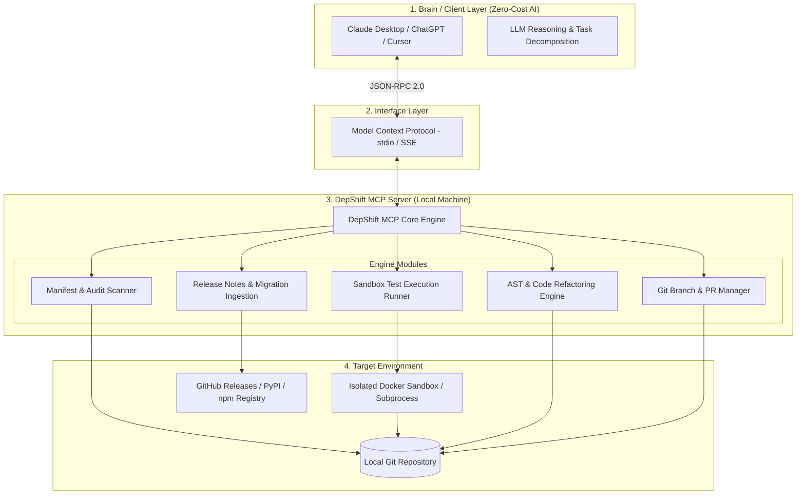
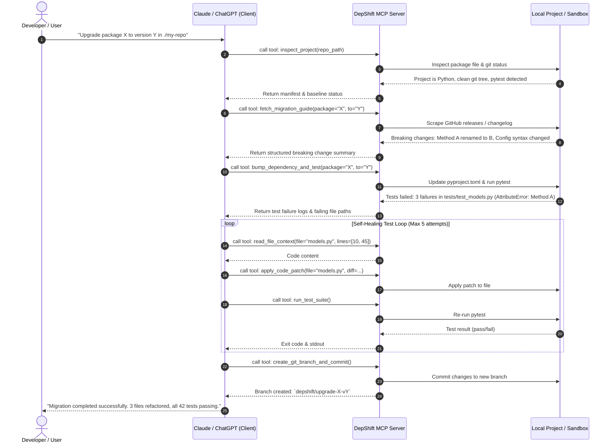

# DepShift MCP: Product & System Architecture Specification

## 1. Executive Summary & Product Vision

### 1.1 What We Are Building
**DepShift MCP** is an autonomous, context-aware dependency migration and security remediation agent. It bridges the gap between *knowing* a dependency is outdated or vulnerable (like Dependabot / Snyk) and *actually fixing the breaking code changes* required to upgrade it.

Delivered as an open **Model Context Protocol (MCP)** server, DepShift turns existing consumer AI subscriptions (Claude Desktop, ChatGPT Desktop, Cursor, or IDE plugins) into a zero-marginal-cost software engineer that upgrades packages, updates deprecated syntax, and iterates until the test suite passes.

### 1.2 The Core Value Proposition
* **The "Dependabot" Dilemma:** Existing tools open pull requests that bump a version number in `package.json` or `pyproject.toml`. In major upgrades (e.g., Pydantic v1 $\rightarrow$ v2, Next.js 12 $\rightarrow$ 14), these PRs fail tests immediately and sit abandoned for months.
* **The DepShift Solution:** DepShift does not just bump versions. It ingests the library's migration guides and release notes, finds all deprecated API call sites across the codebase, refactors the code, runs the test suite in a local loop, fixes any runtime errors, and delivers an audit-ready PR with all tests passing.

---

## 2. Market Analysis & Target Customers

### 2.1 Ideal Customer Profiles (ICPs)

| Customer Segment | Pain Point | Willingness to Pay / Value Driver |
| :--- | :--- | :--- |
| **Mid-Market & Scale-ups (50–500 Engineers)** | Massive backlogs of technical debt. Major framework upgrades take senior engineers away from feature development for weeks. | **High:** Saves hundreds of engineering hours per quarter; accelerates product velocity. |
| **Enterprise Security & Compliance Teams (Fintech, Healthtech)** | Blocked by SOC2 / ISO-27001 / FedRAMP audits due to critical CVEs in dependencies that cannot be easily bumped due to breaking changes. | **Very High:** Avoids regulatory fines and compliance failure penalties. |
| **Software Consultancies & Dev Agencies** | Retained by clients to maintain legacy codebases or modernize older apps on fixed-price contracts. | **Medium-High:** Multiplies gross margins by automating manual refactoring. |
| **Individual Developers / Open Source Maintainers** | Want their side projects and libraries to stay current without manual drudgery. | **Low (Freemium):** Adoption vector via free open-source MCP server. |

### 2.2 Commercialization & Monetization Model (Open-Core)

1. **Free / Community Tier (Open-Source MCP Server):**
   - Runs locally on the developer's laptop via Claude Desktop / Cursor.
   - Connects to their own AI subscription (zero token cost to us).
   - Serves as the developer adoption engine and viral growth hook.
2. **Paid Team / Enterprise Tier (CLI & CI/CD Runner):**
   - Headless background runner triggered by GitHub Actions or GitLab CI.
   - Multi-repo orchestration dashboard.
   - Enterprise compliance audit trails and policy enforcement (e.g., "Auto-migrate any patch/minor vulnerability within 48 hours; auto-stage major upgrades with test proofs").

---

## 3. High-Level System Architecture

### 3.1 Architectural Components

1. **Manifest & Vulnerability Scanner:**
   - Detects project type (Node.js, Python, Go, Rust).
   - Reads dependency locks (`package-lock.json`, `poetry.lock`, etc.).
   - Identifies vulnerable or outdated dependencies with their current and target versions.
2. **Migration Intelligence Engine:**
   - Queries GitHub Releases, npm/PyPI metadata, and official documentation.
   - Extracts breaking changes, removed methods, renamed parameters, and migration snippets.
3. **Sandbox Test & Execution Harness:**
   - Executes commands (`npm test`, `pytest`, `cargo test`) within a controlled timeout boundary.
   - Captures exit codes, stdout, stderr, and structured test summaries (e.g., JUnit XML or pytest reports).
4. **Code Refactoring & Patch Application Engine:**
   - Provides safe file reading, exact line-range patching, and AST search capabilities to the LLM.
5. **Git & PR Lifecycle Manager:**
   - Verifies the working tree is clean before mutating files.
   - Creates dedicated git branches (e.g., `depshift/upgrade-pydantic-v2`).
   - Commits intermediate fixes with informative messages and drafts the final PR body.

---

## 4. End-to-End Operational Workflow

---

## 5. Technology Stack Selection

| Layer | Recommended Choice | Justification |
| :--- | :--- | :--- |
| **MCP Server Language** | **Python 3.11+** | Native ecosystem for rapid scripting, AST parsing (`ast`, `libcst`), subprocess management, and standard MCP SDK (`fastmcp` or `mcp`). |
| **MCP SDK** | **FastMCP** (by jlowin / Prefect) | High-level decorator-based API with automatic type validation via Pydantic; extremely clean and robust. |
| **Sandboxing & Execution** | **Python `subprocess` + optional Docker container** | Native `subprocess` with strict timeouts and cwd isolation for local trusted repos; Docker containers for untrusted external repos. |
| **Code Refactoring Tools** | **LibCST / Regex / Diff tools** | Python's `libcst` allows concrete syntax tree modification preserving formatting, or precise unified-diff patch application. |
| **Git Operations** | **GitPython** or native `git` CLI | Clean programmatic management of branches, staged diffs, and commits. |
| **Documentation Scraper** | **`httpx` + `BeautifulSoup4` + GitHub API** | Fast, asynchronous fetching of changelogs, markdown files, and release assets. |

---

## 6. Safety, Edge Cases & Failure Modes

1. **Flaky or Pre-existing Failing Tests:**
   - *Safeguard:* The agent runs a baseline test suite *before* touching any code. If baseline tests fail, it halts and informs the user rather than blaming the dependency upgrade.
2. **Infinite Loops / AI Hallucination:**
   - *Safeguard:* Hard-coded retry budget (e.g., maximum 5 fix attempts per failing test). If the budget is exhausted, the agent stops, reverts the files, or checks in a work-in-progress branch flagged with `[ATTENTION NEEDED]`.
3. **Dirty Git Working Trees:**
   - *Safeguard:* Strict pre-flight check. If uncommitted changes exist in the user's repository, the agent refuses to modify files until the user stashes or commits their work.
4. **Destructive Command Guardrail:**
   - *Safeguard:* Test execution commands are whitelist-validated (e.g. `npm test`, `pytest`, `cargo test`, `mvn test`). Arbitrary shell scripts like `rm -rf` or arbitrary `curl` piped to bash are blocked.
